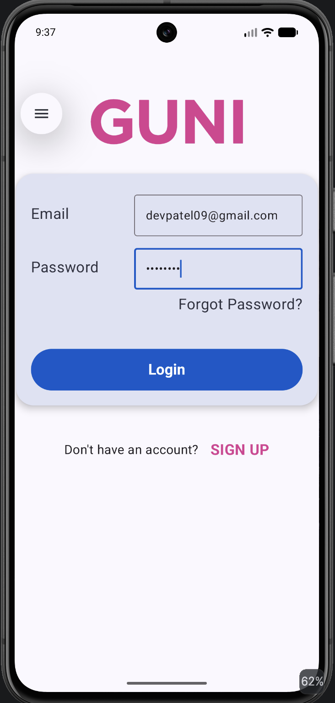
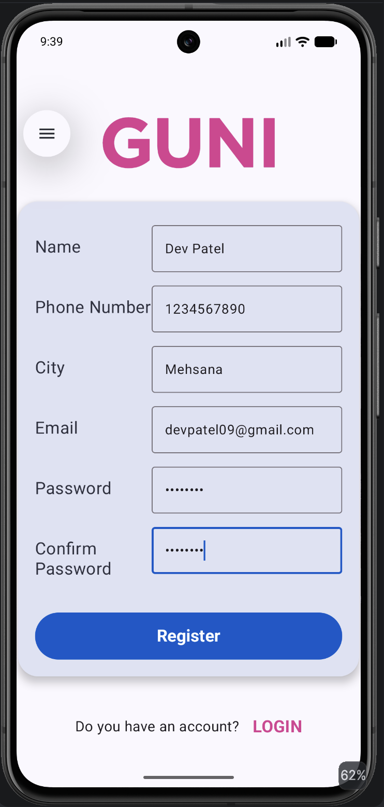

<h1 align="center">🔐 Practical-5</h1>

  <b>Login &amp; Registration Screens using Jetpack Compose</b>

  
  
  
  

---

**Aim:** To develop an Android application that includes Login and Registration screens using Jetpack Compose.

**Study:** Jetpack Compose Course

## 🔗 Project Description

This application demonstrates building a complete authentication UI entirely in **Jetpack Compose** with **Kotlin**, with no XML layouts. The app is branded **GUNI** and contains two screens, **Login** and **Register**, that the user can switch between with a single tap. Both screens follow the system theme, so the same UI looks right in **light mode** and **dark mode**.

Every field is validated before submission, and errors appear inline beneath the field that needs attention. A successful login or registration shows a confirmation toast, and a successful registration returns the user to the Login screen.

## ✨ Features

| | Feature | Details |
|---|---|---|
| 🎨 | **Pure Compose UI** | No XML layout, the whole UI is built from composable functions |
| 🌗 | **Light &amp; Dark theme** | Custom Material 3 colour schemes selected from `isSystemInDarkTheme()` |
| ✅ | **Form validation** | Inline error messages shown under each invalid field |
| 🔁 | **Screen switching** | Login ⇄ Register using a single state flag, no navigation library needed |
| 💾 | **State survives rotation** | Field values and the current screen are kept with `rememberSaveable` |
| ⌨️ | **Keyboard aware** | Correct keyboard per field, masked passwords, and `imePadding()` keeps fields visible |
| 📜 | **Scrollable** | The Register form scrolls on small screens |

## 🧩 Key Components

- **MainActivity:** The single entry point. Enables edge-to-edge, wraps everything in `GuniTheme`, and holds the `onLogin` state that decides whether `LoginScreen` or `RegisterScreen` is shown.

- **GuniTheme:** Chooses a custom `darkColorScheme` or `lightColorScheme` depending on the system theme and applies it through `MaterialTheme`.

- **AuthScaffold:** The layout both screens share: the GUNI logo, the rounded elevated form card, and the "Don't have an account? / Do you have an account?" footer link.

- **FormRow:** A reusable label + `OutlinedTextField` row with a placeholder, error state, supporting error text, keyboard type, and optional password masking.

- **LoginScreen:** Email and password fields, a "Forgot Password?" action, and the Login button.

- **RegisterScreen:** Name, phone number, city, email, password, and confirm password fields with the Register button.

- **Logo (`guni_pink.png`):** The pink GUNI brand logo stored in `res/drawable` and drawn with `Image` + `painterResource`.

- **State Management:** `remember`, `mutableStateOf`, and `rememberSaveable` hold the field values and the "submitted" flag that triggers error display.

- **Toast:** Gives the user feedback for a successful login, registration, or password-reset request.

## 📋 Validation Rules

| Screen | Field | Rule |
|---|---|---|
| Login | Email | Required, must be a valid email address |
| Login | Password | Required |
| Register | Name | Required |
| Register | Phone Number | Exactly 10 digits |
| Register | City | Required |
| Register | Email | Required, must be a valid email address |
| Register | Password | At least 6 characters |
| Register | Confirm Password | Must match Password |

> Errors are shown only after the button is pressed, so the user is not interrupted while typing.

## 🛠️ Tech Stack

| Layer | Technology |
|---|---|
| Language | Kotlin |
| UI Toolkit | Jetpack Compose + Material 3 |
| Theming | Custom `ColorScheme` (light and dark) |
| State | `remember` / `rememberSaveable` |
| Build | Gradle (Kotlin DSL) with the Compose compiler plugin |
| Min SDK | 24 |

## 📱 Screenshots

### ☀️ Light Mode

  
  &nbsp;&nbsp;&nbsp;&nbsp;
  

<b>Login</b> &nbsp;•&nbsp; <b>Register</b>

  👤 <b>Dev Patel</b> &nbsp;•&nbsp; 🆔 <b>24012011080</b> &nbsp;•&nbsp; 🕒 Last Updated: <b>October 10, 2026</b>

